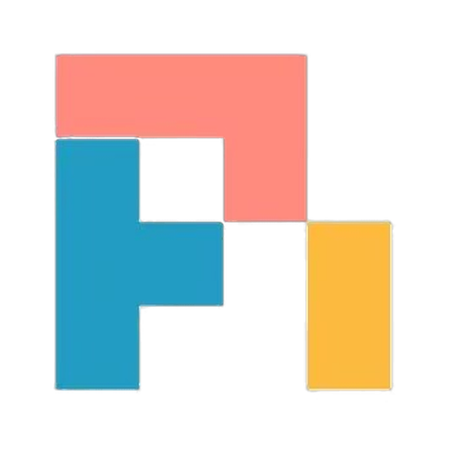
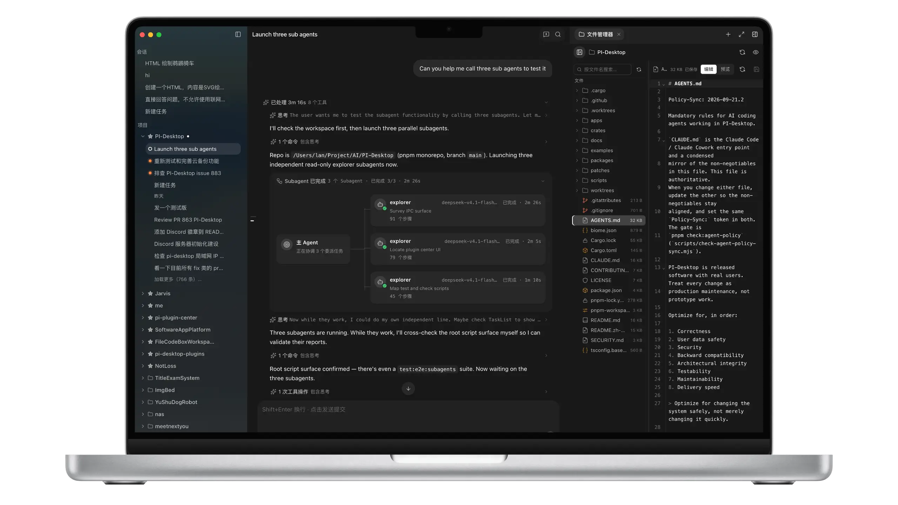
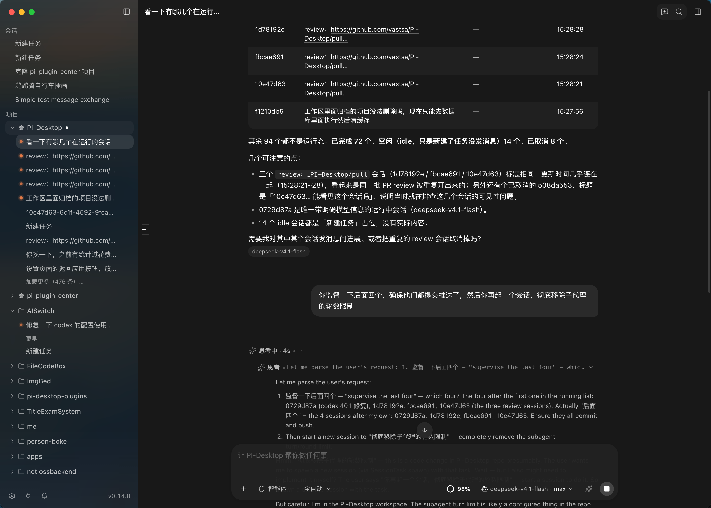
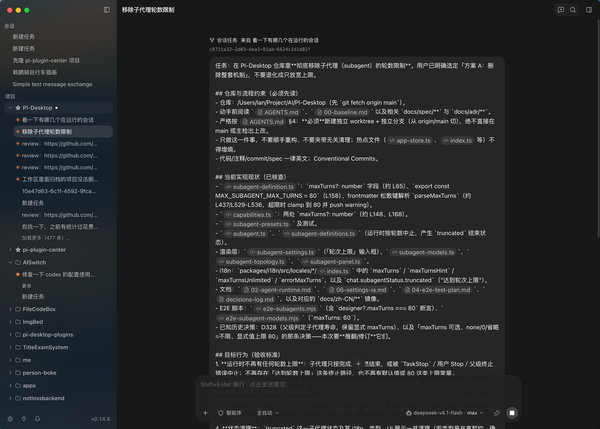
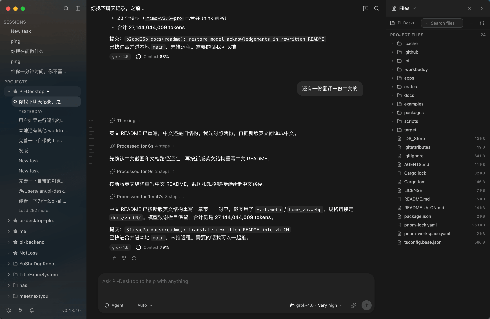
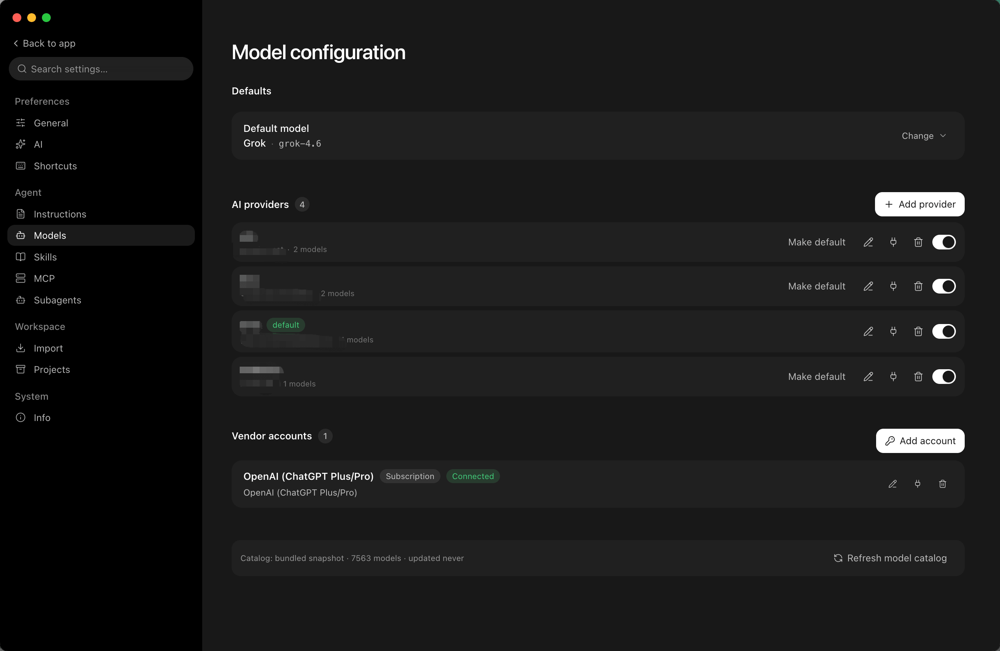
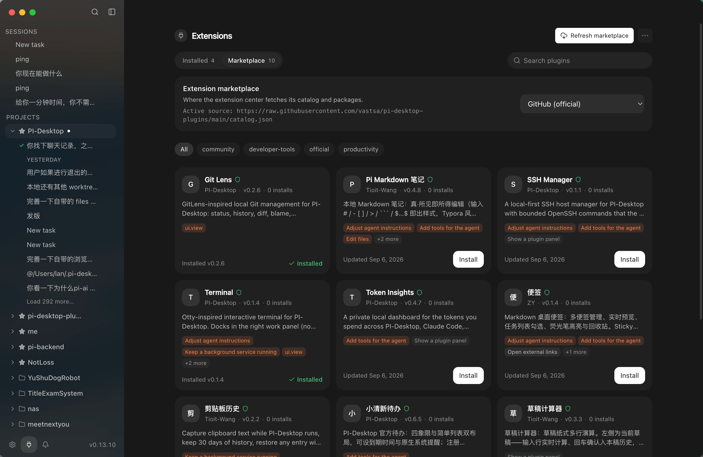
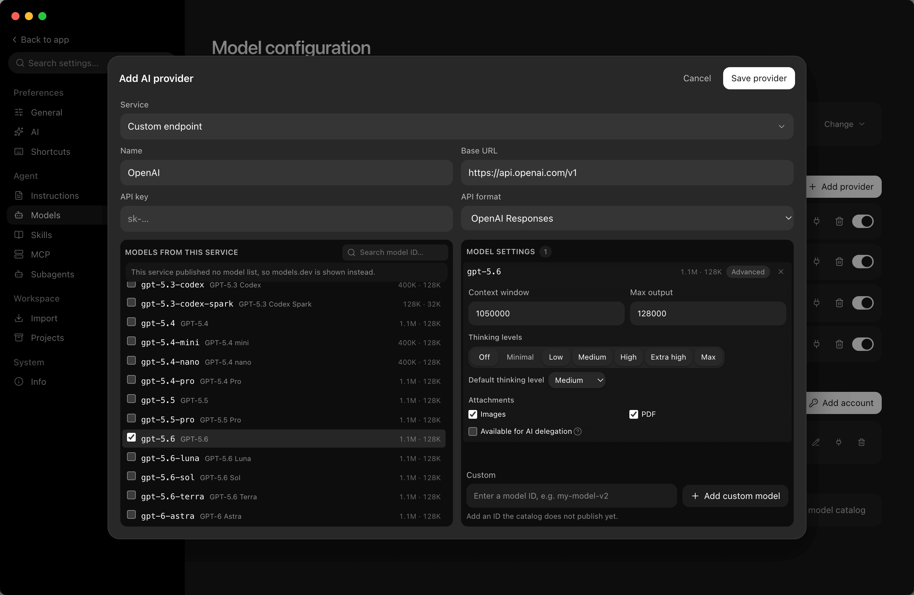

<div align="center">



# PI-Desktop

### A modular desktop workspace for AI agents

**Bring projects, agents, models, plugins, and workflows into one persistent desktop environment.**

Local-first · Model-agnostic · Plugin-powered · macOS / Windows / Linux

<br />

**Unofficial fork of [vastsa/PI-Desktop](https://github.com/vastsa/PI-Desktop). Windows builds are published by this fork and are not affiliated with the upstream project.**

<br />

[](https://github.com/wen676628-cell/pi-desktop/releases/latest)
[](https://github.com/wen676628-cell/pi-desktop/releases)
[)](https://github.com/vastsa/PI-Desktop/stargazers)
[](https://github.com/wen676628-cell/pi-desktop/actions/workflows/ci.yml)
[](LICENSE)
[](https://www.reddit.com/r/AIUO/)

<br />

**[Download](https://github.com/wen676628-cell/pi-desktop/releases/latest)** ·
[Documentation](https://pi-docs.aiuo.net/) (upstream documentation) ·
[Build a Plugin](docs/plugin-development.md) ·
[Screenshots](docs/guide/screenshots.md) ·
[简体中文](README.zh-CN.md)

<br />



<br />

**Your projects stay local · Your models stay replaceable · Your workspace stays yours**

</div>

> **Current release line: 0.22.x (Early Preview).**

---

## How this fork differs from upstream

This fork tracks [vastsa/PI-Desktop](https://github.com/vastsa/PI-Desktop) and regularly syncs its main line. On top of the synced upstream code, the fork ships these changes — every one of them merged through a reviewed PR with regression tests:

| Area | What this fork changes | Why |
| --- | --- | --- |
| **Release automation** | The release workflow publishes Windows installers, portable builds, and the GitHub Release automatically — the macOS lane falls back to unsigned packaging instead of failing without Apple certificates. | Upstream requires Developer ID signing secrets; the fork ships unsigned Windows-first builds. |
| **Security hardening** | Local plugin packages go through a pre-install permission review; provider secrets are wrapped with OS secure storage; the general IPC bridge only answers trusted first-party renderers; remote media in replies waits for a click. | Defense in depth on top of the upstream permission model, without changing upstream contracts. |
| **Reliability** | Marketplace downloads and batch updates release the host lock while data moves; restart recovery commits dead letters before removing queue entries, so a failed write cannot lose a record. | Keeps the host responsive during slow transfers and protects recovery data. |
| **Startup & UX** | The agent sidecar starts on first use instead of at boot; permission choices are named *Confirm before changes / Auto review / Full access* with `/agent`, `/plan`, `/goal` mode commands; a fork identity and `CHANGELOG.md` live at the repo root. | Faster cold start, clearer permission naming, fork-transparent repository. |
| **Platform focus** | Windows x64 installers and portable builds are published for every release; macOS builds are unsigned; Linux packages are built by CI. | Windows is the fork's primary target platform. |

Fork-specific modules (LSP diagnostics host, trusted-renderer IPC gate, OS-wrapped secret key resolver) live beside the upstream code and never change upstream contracts — public APIs, storage schema, and the host protocol stay compatible, so upstream syncs stay clean.

See [CHANGELOG.md](CHANGELOG.md) for per-release details, and [docs/fork-sync-strategy.md](docs/fork-sync-strategy.md) for how upstream changes are absorbed.

---

## Why PI-Desktop?

Terminal agents are great at execution. IDE agents are great at living inside an editor.

PI-Desktop goes one step further:

> **Give AI agents a persistent, independent, and extensible desktop workspace of their own.**

<table>
<tr>

<td width="25%" valign="top">

### Independent Workspace

No dependency on a specific IDE or terminal.

Projects, sessions, reviews, previews, and agents all live in their own workspace.

</td>

<td width="25%" valign="top">

### Plugin-Powered

Plugins extend more than the agent.

Add panels, views, widgets, tools, MCP servers, themes, and background services.

</td>

<td width="25%" valign="top">

### Agent Orchestration

One agent is not always enough.

Delegate to Subagents or coordinate full Worker Sessions in parallel.

</td>

<td width="25%" valign="top">

### Model Freedom

Cloud models, local models, custom gateways, compatible APIs.

Switch models without rebuilding your workflow.

</td>

</tr>
</table>

<div align="center">

**It is not a wrapper around one model. It is not another IDE extension.**

### It is a desktop platform for agent workflows.

</div>

---

## Plugins are part of the workspace, not an afterthought

PI-Desktop keeps the Core focused.

**Your actual workflow is assembled through extensions.**

<table>
<tr>

<td width="33%" valign="top">

### Agent

Extend what the agent can do

**Agent Tools**
**Skills**
**Completion**
**pi Extensions**

</td>

<td width="33%" valign="top">

### Workspace

Extend the desktop itself

**Commands**
**Panels**
**Work Panel Views**
**Floating Widgets**
**Themes**

</td>

<td width="33%" valign="top">

### Platform

Extend the runtime

**MCP Servers**
**Resident Services**
**Plugin Message Bus**

</td>

</tr>
</table>

A plugin does not have to be “just another tool.”

It can be an entire product:

```text
Voice Agent
├── Floating Widget
├── Speech Service
├── Agent Tool
└── Commands

GitHub Workspace
├── Work Panel
├── MCP Server
├── Agent Tools
└── Background Service

Session Analytics
├── Dashboard
├── Commands
└── Workspace View
```

### What can a plugin add?

| Capability          | What it enables                                                |
| ------------------- | -------------------------------------------------------------- |
| **Command**         | Add actions to the global command system                       |
| **Panel**           | Open a standalone plugin interface                             |
| **Floating Widget** | Build voice orbs, status lights, timers, and other floating UI |
| **Work Panel View** | Add new views to the right-side workspace                      |
| **Agent Tool**      | Register tools callable by the agent                           |
| **Completion**      | Use the models already configured by the user                  |
| **Skill**           | Add reusable agent capabilities and workflows                  |
| **Theme**           | Customize workspace appearance                                 |
| **MCP Server**      | Connect local or remote MCP servers                            |
| **Service**         | Run persistent background work                                 |
| **Message Bus**     | Let plugins communicate with each other                        |

Plugins can be distributed as `.piplug` packages or installed through the marketplace.

<div align="center">

### [Build your first plugin →](docs/plugin-development.md)

</div>

---

## One foundation, many workflows

```text
                         PI-Desktop
                             │
          ┌──────────────────┼──────────────────┐
          │                  │                  │
        Agent            Workspace           Platform
          │                  │                  │
     Agent Tools           Panels              MCP
       Skills             Widgets            Services
     Subagents             Views            Message Bus
   pi Extensions          Themes
          │                  │                  │
          └──────────────────┼──────────────────┘
                             │
                       Your Workflow
```

PI-Desktop can simply be your coding agent.

Or you can turn it into:

**AI Development Workspace · Voice Agent · DevOps Console · GitHub Workspace · Data Assistant · Multi-Agent Control Center · Automation Platform**

> **The Core provides the foundation. Plugins decide what your workspace becomes.**

---

## Three ways to work

<table>
<tr>

<td width="33%" valign="top">

### Agent

**Give it a task. Let it work.**

Read code, edit files, run commands, test, and iterate.

Best for day-to-day development.

</td>

<td width="33%" valign="top">

### Plan

**Review the approach before execution.**

The agent studies the project first and produces an implementation plan.

Best for refactors and high-risk changes.

</td>

<td width="33%" valign="top">

### Goal

**Define the outcome. Let the agent choose the path.**

Lock the objective and acceptance criteria, then let the agent drive execution.

Best for complex and long-running tasks.

</td>

</tr>
</table>

Privileged operations still pass through PI-Desktop's permission layer.

---

## When one agent is not enough

Complex work should not be forced into one context window.

PI-Desktop provides two levels of delegation.

### Subagents

Delegate independent work to background agents:

**Code exploration · Implementation · Test analysis · Research · Review**

Each Subagent gets its own context and reports the result back to the parent agent.

### Session Orchestrator

For longer-lived work, delegate to full Worker Sessions.

```text
Main Session
│
├── Worker A
│   └── Frontend
│
├── Worker B
│   └── Backend
│
├── Worker C
│   └── Tests
│
└── Worker D
    └── Review
```

Workers are full PI-Desktop sessions:

**Independent context · Independent execution · Directly inspectable · Reusable · Full transcript**

<table>
<tr>

<td width="50%">



<p align="center"><sub>Coordinate multiple Worker Sessions from one parent Session</sub></p>

</td>

<td width="50%">



<p align="center"><sub>Each Worker remains a full, inspectable Session</sub></p>

</td>

</tr>
</table>

<div align="center">

**Move from “one agent helps me code” to “multiple agents divide and complete the work.”**

</div>

---

## Built for work that lasts

PI-Desktop is organized around:

<div align="center">

### Project → Session → Agent → Work

</div>

—not around disposable chat threads.

You can:

* Manage multiple projects and sessions
* Pin, archive, branch, and search sessions
* Queue prompts while an agent is already running
* Reference project files with `@`
* Use slash commands
* Review diffs
* Inspect command output
* Work with the right-side Work Panel
* Keep streaming checkpoints
* Recover interrupted work whenever possible

**A Session can continue across multiple app launches.**

---

## See what the agent is doing

<table>
<tr>

<td width="50%">



<p align="center"><sub>Persistent Sessions instead of disposable chats</sub></p>

</td>

<td width="50%">



<p align="center"><sub>Switch models and reasoning levels inside the Session</sub></p>

</td>

</tr>

<tr>

<td width="50%">



<p align="center"><sub>A plugin marketplace that extends both the agent and the desktop</sub></p>

</td>

<td width="50%">



<p align="center"><sub>Connect your own provider, gateway, or local model</sub></p>

</td>

</tr>
</table>

<div align="center">

**[Explore more screenshots →](docs/guide/screenshots.md)**

</div>

---

## Swap the model, keep the workflow

PI-Desktop does not tie your workflow to a single model vendor.

Use:

**OpenAI · Anthropic · OpenAI-Compatible APIs · Custom Gateways · Ollama · LM Studio · Local Models**

Configure each model independently:

**Provider · Model ID · Context Window · Output Limit · Reasoning / Thinking · Temperature · OAuth · API Key · Endpoint**

Different Sessions can use different models.

The same Session can switch models at any time.

```text
Planning     → Model A
Coding       → Model B
Review       → Model C
Private Task → Local Model
```

> **The model is a replaceable component of the workflow — not the workflow itself.**

---

## Already using another coding agent?

Keep your existing work.

PI-Desktop can import local sessions from:

**Claude Code · Codex · OpenCode · Pi**

---

## Local-first

PI-Desktop does not require you to move your development environment into our cloud.

| Data                 | Default behavior                          |
| -------------------- | ----------------------------------------- |
| Projects             | Local                                     |
| Sessions             | Local                                     |
| Settings             | Local                                     |
| Logs                 | Local                                     |
| API credentials      | OS Keychain                               |
| PI-Desktop telemetry | None                                      |
| Model requests       | Sent directly to your configured provider |

**No mandatory PI-Desktop account.**

**No mandatory PI-Desktop relay.**

When using a remote model, the context required for the request is sent directly to that provider.

---

## You control the permissions

Agents can read files, edit code, run commands, call tools, use extensions, and delegate work.

Privileged operations still pass through the permission layer:

```text
Agent
  ↓
Tool Request
  ↓
Permission Layer
  ↓
Allow / Ask / Deny
  ↓
Execution
```

**You decide how much autonomy each Session gets.**

---

## Get started

<table>
<tr>

<td width="25%" valign="top">

### 01

**Download**

Install PI-Desktop

</td>

<td width="25%" valign="top">

### 02

**Connect a model**

Configure a Provider

</td>

<td width="25%" valign="top">

### 03

**Open a project**

Choose a local repository

</td>

<td width="25%" valign="top">

### 04

**Start working**

Agent / Plan / Goal

</td>

</tr>
</table>

<div align="center">

### [Download PI-Desktop →](https://github.com/wen676628-cell/pi-desktop/releases/latest)

**macOS · Windows · Linux**

Unofficial fork builds: this fork currently publishes **Windows** installers and portable executables. macOS and Linux packages listed below describe the upstream release matrix and are not published here yet.

</div>

### Packages

| Platform | Architecture  | Package                                 |
| -------- | ------------- | --------------------------------------- |
| macOS    | Apple Silicon | `.dmg` / `.zip`                         |
| macOS    | Intel         | `.dmg` / `.zip`                         |
| Windows  | x64           | Installer / `.zip`                      |
| Linux    | x64 / ARM64   | `.AppImage` / `.deb` / `.rpm` / `.asar` |

macOS releases are signed with a Developer ID certificate and notarized by Apple.

<details>
<summary><strong>Linux Compatibility</strong></summary>

<br />

Linux packages require **glibc 2.35+**.

Common supported distributions include:

* Ubuntu 22.04+
* Debian 12+
* Fedora 36+

Check your current version with:

```bash
ldd --version
```

</details>

---

## Built on Pi

PI-Desktop is built on the [pi](https://github.com/badlogic/pi-mono) ecosystem.

The Agent Runtime uses:

* `pi-ai`
* `pi-agent-core`
* `pi-coding-agent`

> **Pi provides the Agent Engine. PI-Desktop builds the persistent desktop workspace, sessions, permissions, plugins, and agent orchestration around it.**

---

## For Developers

PI-Desktop can also serve as a host platform for building agent products.

You can build:

**Plugins · MCP Servers · Skills · Agent Tools · pi Extensions · Themes · Panels · Floating Widgets · Background Services**

### Plugin quick start

Built-in templates include:

* `panel-basic`
* `agent-tool-basic`
* `skill-pack`
* `full-demo`

Plugins can be created and loaded directly as Development Plugins.

**[Plugin Development Guide →](docs/plugin-development.md)**

### Run from source

<details>
<summary><strong>Development Setup</strong></summary>

<br />

#### Requirements

* Node.js `>=22.19`
* pnpm `>=10`
* Stable Rust Toolchain

#### Start

```bash
# This fork:
git clone https://github.com/wen676628-cell/pi-desktop.git
cd pi-desktop

# Upstream project:
# git clone https://github.com/vastsa/PI-Desktop.git

pnpm install

cargo build -p host-core
pnpm build:js

pnpm dev
```

#### Validate

```bash
pnpm typecheck
pnpm lint
pnpm test
```

</details>

### Documentation

[Documentation](https://pi-docs.aiuo.net/) ·
[Architecture](docs/spec/02-architecture/01-architecture.md) ·
[Specification](docs/spec/README.md) ·
[Plugin Development](docs/plugin-development.md) ·
[E2E Test Plan](docs/spec/06-delivery/04-e2e-test-plan.md) ·
[Release Runbook](docs/spec/06-delivery/06-release-runbook.md) ·
[AGENTS.md](AGENTS.md)

---

## Contributing

Contributions are welcome:

**Issues · Pull Requests · Plugins · Skills · MCP Integrations · Documentation · Translations**

For standalone capabilities, consider one question first:

> **Would this be better as a Plugin?**

Keep the Core focused. Let the ecosystem grow.

**[Report an Issue](https://github.com/wen676628-cell/pi-desktop/issues/new/choose)** (fork) ·
[Open Issues](https://github.com/wen676628-cell/pi-desktop/issues) ·
[Upstream Issues](https://github.com/vastsa/PI-Desktop/issues) ·
[Build a Plugin](docs/plugin-development.md)

---

## Project Trend

<div align="center">

<a href="https://trendshift.io/repositories/178787?utm_source=repository-badge&amp;utm_medium=badge&amp;utm_campaign=badge-repository-178787">

</a>

</div>

---

## Friends

[Linux.Do](https://linux.do/) — A new ideal community

---

## Model Acknowledgements

> **Not by a lone genius, but by a token-powered construction crew.**

PI-Desktop has been built with the help of models from multiple providers.

More than **27 billion tokens** have been used across development, refactoring, review, design, and debugging.

Thanks to every human contributor — and every model that helped us build it.

---

## License

PI-Desktop is licensed under the **GNU Lesser General Public License v3.0**.

See [LICENSE](LICENSE) for details.

---

<div align="center">


## PI-Desktop

### Build your own Agent workspace.

**Your models · Your agents · Your plugins · Your workspace**

<br />

**[Download](https://github.com/wen676628-cell/pi-desktop/releases/latest)** ·
[Documentation](https://pi-docs.aiuo.net/) (upstream documentation) ·
[Build a Plugin](docs/plugin-development.md)

<br /><br />

<sub>Local-first · Model-agnostic · Plugin-powered</sub>

</div>
